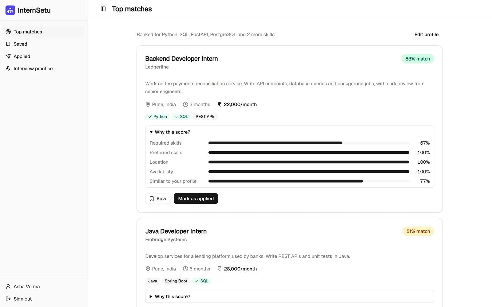
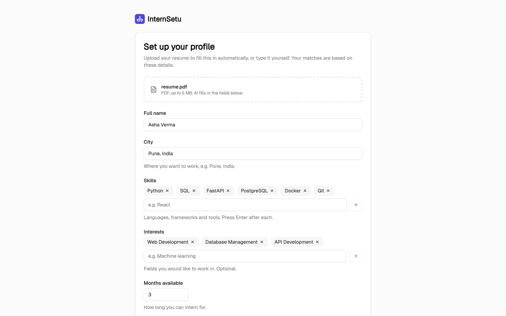
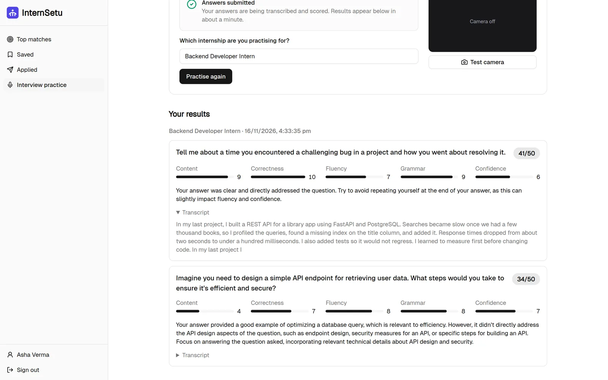
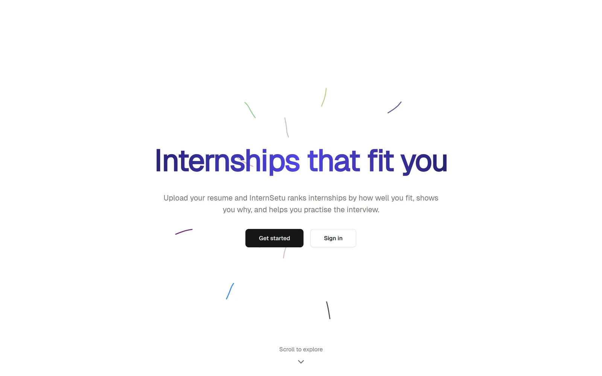
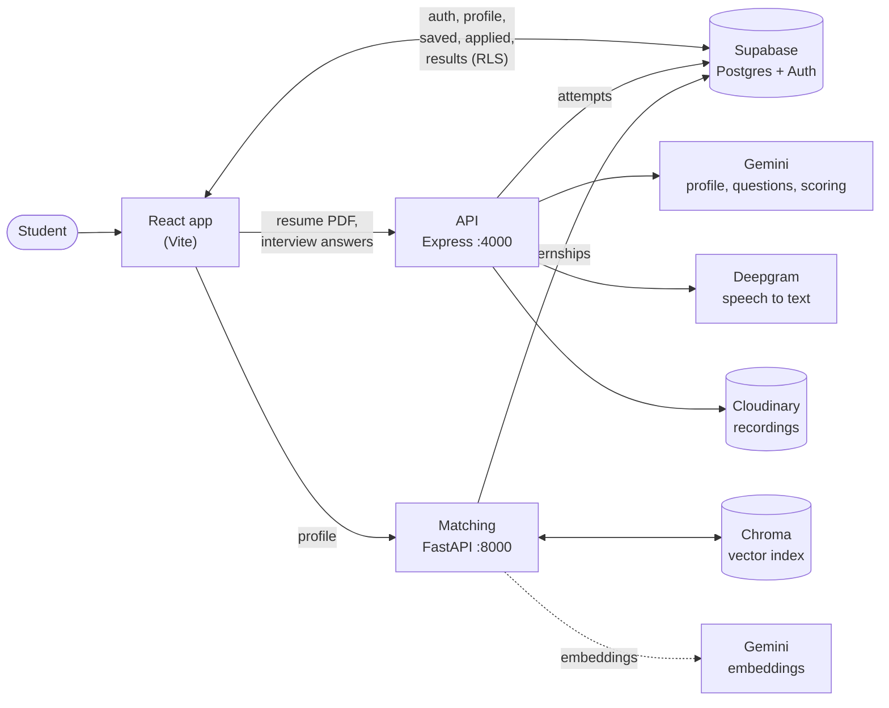

<div align="center">


# InternSetu

**Upload your resume, get internships ranked by how well you fit, then practise the interview.**

<br>


**[How it works](#how-it-works)** · **[Run locally](#run-locally)** · **[Testing](#testing)**

</div>

<br>

Finding an internship usually means scrolling long lists and guessing which ones you have a real chance at. InternSetu reads your resume, fills in your profile for you, and ranks internships by how well your skills, location and availability fit each one, with a score that shows *why*. When you find one you like, you can sit a short recorded mock interview: AI writes the questions for the role, and every spoken answer is transcribed, scored on five criteria and given feedback.

<p align="center">
  
</p>

## Features

<table>
  <tr>
    <td width="50%" valign="top">
      
      <h3>Resume to profile in one upload</h3>
      Drop in a PDF. The API extracts the text and Gemini turns it into a structured profile (name, city, skills, interests, months free) that you check and save. Gemini's JSON schema mode guarantees a well-formed answer, and the server validates it again before it reaches the form.
    </td>
    <td width="50%" valign="top">
      
      <h3>Matches with a reason</h3>
      Every internship gets a score out of 100 from five parts: required skills, preferred skills, location, availability, and how close the role is in meaning to your profile. Open <i>Why this score?</i> to see each part. Skills you already have are ticked.
    </td>
  </tr>
  <tr>
    <td width="50%" valign="top">
      
      <h3>AI mock interview</h3>
      Name the role and get two questions written for it. You get 20 seconds to think and 90 to answer on camera. Each answer is stored, transcribed by Deepgram and scored by Gemini on content, correctness, fluency, grammar and confidence, with feedback on what to do better.
    </td>
    <td width="50%" valign="top">
      
      <h3>A shortlist that stays</h3>
      Save internships and mark the ones you have applied to; both lists live in your account. The interview runs full screen, and switching tabs ends and flags the attempt, so a score means the answer was given unaided.
    </td>
  </tr>
</table>

Also: email and Google sign-in, password reset, a private profile that pre-fills next time, and lazy-loaded pages so the landing page stays light.

## How it works



The app has three parts, and every request from the browser carries the user's Supabase access token, which each service verifies.

1. **Profile.** The React app sends the resume to the **API**, which reads the PDF, asks Gemini for a profile in a fixed JSON schema, and cleans the result. The student saves it to their `profiles` row in Supabase.
2. **Matching.** At start-up the **matching service** loads every internship from Supabase and embeds it with `gemini-embedding-001` into a persistent Chroma collection. The collection name is a hash of the data, so restarts reuse the vectors and any change to the listings rebuilds them. For a profile, Chroma finds the closest candidates, then each one is scored:

   | Part | Weight | How it is measured |
   | --- | --- | --- |
   | Required skills | 40% | Share of the required skills you have (extra skills never count against you) |
   | Preferred skills | 20% | Share of the nice-to-have skills you have |
   | Location | 15% | Same city, or the role is remote |
   | Availability | 10% | Whether you are free for the whole internship |
   | Meaning | 15% | Cosine similarity between your profile and the listing |

3. **Interview.** The **API** asks Gemini for two questions. Each recorded answer is uploaded to Cloudinary and saved as an `interview_attempts` row; the API replies at once and then transcribes and scores the answer in the background. The app polls until the score appears. Empty answers score 0 without calling the model, and the total is always computed by the server, never taken from the model.

**Data and security.** Row-level security keeps every table private to its owner; internships are read-only for everyone. Interview attempts can only be written by the API's secret key. All AI keys stay on the servers, and the API rate-limits AI calls per user.

## Tech stack

| Layer | Tools |
| --- | --- |
| Frontend | React 18, TypeScript, Vite, Tailwind CSS 4, shadcn/ui, TanStack Query, React Router 7, Motion |
| API | Node.js, Express 5, Multer, pdf-parse, express-rate-limit, Cloudinary SDK |
| Matching | Python 3.11, FastAPI, Chroma, NumPy |
| AI | Gemini 2.5 Flash-Lite (profiles, questions, scoring), Gemini embeddings, Deepgram Nova-3 (speech to text) |
| Data and auth | Supabase Postgres with row-level security, Supabase Auth (email and Google) |
| Quality | Vitest, node:test, pytest, ESLint, GitHub Actions |

## Run locally

**You need:** Node.js 20.12+, Python 3.11+, the [Supabase CLI](https://supabase.com/docs/guides/local-development/cli/getting-started), and accounts for [Supabase](https://supabase.com), [Google AI Studio](https://aistudio.google.com/apikey), [Cloudinary](https://cloudinary.com) and [Deepgram](https://deepgram.com).

**1. Database.** Create a Supabase project, then push the schema, the 25 sample internships and the auth settings:

```bash
supabase login
supabase link --project-ref <your-project-ref>
supabase db push --include-seed   # tables, row-level security, sample internships
supabase config push              # auth settings from supabase/config.toml
```

For Google sign-in, turn on the Google provider in *Authentication → Sign In / Providers*.

**2. API** (resume parsing and interviews), on http://localhost:4000:

```bash
cd backend/api
cp .env.example .env    # fill in the values below
npm install
npm run dev
```

| Variable | What it is |
| --- | --- |
| `SUPABASE_URL` | The Supabase project URL |
| `SUPABASE_SECRET_KEY` | The Supabase secret key (server only) |
| `GEMINI_API_KEY` | Google AI Studio key |
| `CLOUDINARY_CLOUD_NAME`, `CLOUDINARY_API_KEY`, `CLOUDINARY_API_SECRET` | Cloudinary credentials, for recordings |
| `DEEPGRAM_API_KEY` | Deepgram key, for transcripts |
| `CORS_ORIGINS` | Sites allowed to call the API, comma-separated |
| `GEMINI_MODEL` | Optional; defaults to `gemini-2.5-flash-lite` |

**3. Matching service**, on http://localhost:8000:

```bash
cd backend/matching
cp .env.example .env    # SUPABASE_URL, SUPABASE_SECRET_KEY, GEMINI_API_KEY, CORS_ORIGINS
python -m venv .venv
source .venv/bin/activate    # Windows: .venv\Scripts\activate
pip install -r requirements.txt
uvicorn main:app --port 8000
```

**4. Frontend**, on http://localhost:5173:

```bash
cd frontend
cp .env.example .env    # VITE_SUPABASE_URL, VITE_SUPABASE_PUBLISHABLE_KEY, VITE_API_URL, VITE_MATCHING_URL
npm install
npm run dev
```

## Testing

```bash
cd frontend && npm run lint && npm run typecheck && npm test   # Vitest
cd backend/api && npm test                                       # node:test, API routes run against fakes
cd backend/matching && pip install -r requirements-dev.txt && pytest
```

GitHub Actions runs all three on every push and pull request.

## Project structure

```
frontend/src/
  pages/                  landing, sign-in, profile, matches, saved, applied, interview
  components/             app shell, internship card, interview pieces, ui/ (shadcn)
  hooks/                  auth and data hooks (TanStack Query)
  lib/                    API client, Supabase client, types, validation
backend/api/src/
  routes/                 /api/resume, /api/interview
  services/               resume parsing, interview questions and scoring
  lib/  middleware/       Gemini, Deepgram, Cloudinary clients; auth and errors
backend/matching/
  main.py                 FastAPI app, auth, /match
  matching.py             embeddings, Chroma index, the match score
supabase/
  migrations/             tables, row-level security, triggers
  seed.sql                25 sample internships
```

## License

Copyright © 2026 Suryansh Pratap Singh. All rights reserved. The source is public to read; it is not licensed for reuse.
