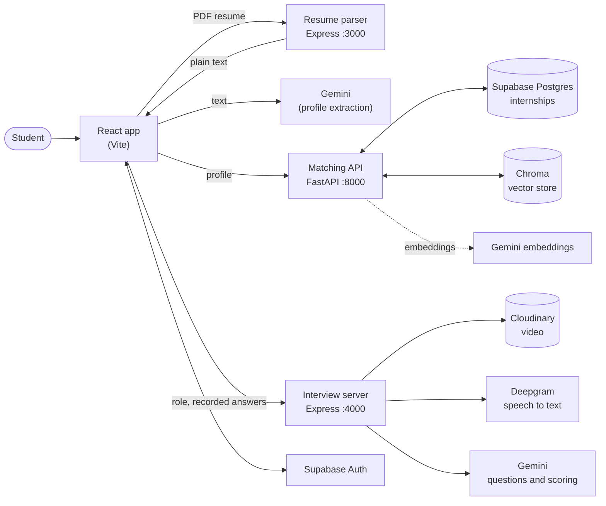

<div align="center">

# InternSetu

**Upload your resume, get internships ranked by how well you fit, then practise the interview.**

<br>


**[How it works](#how-it-works)** · **[Run locally](#run-locally)** · **[API](#api)**

</div>

<br>

Finding an internship usually means scrolling long lists and guessing which ones you have a real chance at. InternSetu reads your resume, fills in your profile for you, and ranks internships by how well your skills, location and availability fit each one, with a score that shows *why*. When you find one you like, you can sit a short recorded mock interview: Gemini writes the questions for the role, and every answer is transcribed and scored.

## Features

<table>
  <tr>
    <td width="50%" valign="top">
      <h3>Resume to profile in one upload</h3>
      Drop in a PDF resume. The backend pulls out the text, and Gemini turns it into a profile (name, location, skills, interests, how many months you are free) that you can check and edit before you submit.
    </td>
    <td width="50%" valign="top">
      <h3>Matches with a reason</h3>
      Each internship gets a score out of 100 built from five parts: required skills, preferred skills, location, duration and how close the description is in meaning to your profile. You see the parts, not just the total.
    </td>
  </tr>
  <tr>
    <td width="50%" valign="top">
      <h3>AI mock interview</h3>
      Type the role you are going for and Gemini writes two interview questions for it. You answer each one on camera; the recording is uploaded, transcribed by Deepgram, and scored by Gemini on fluency, correctness, grammar, hesitation and content.
    </td>
    <td width="50%" valign="top">
      <h3>A fair attempt</h3>
      The interview runs full screen. Switching tabs, leaving the window or closing the page ends the attempt and logs why, so a score means the candidate answered without help.
    </td>
  </tr>
</table>

Also: email and Google sign-in through Supabase Auth, and a dashboard that keeps your matches for the session.

## How it works



1. **Read the resume.** The React app sends the PDF to the resume parser, which returns the raw text with `pdf-parse`. Gemini then turns the text into a structured profile.
2. **Index the internships.** When the matching API starts, it loads every internship from the Supabase `internships` table, turns each into a document (title, company, location, stipend, skills, description) and embeds it with Gemini embeddings into a Chroma vector store saved on disk. The store is keyed by a hash of the data, so a restart reuses it and any change to the listings rebuilds it.
3. **Match.** For a profile, the API finds the closest internships in Chroma, then scores each one:

   | Part | Weight | How it is measured |
   | --- | --- | --- |
   | Required skills | 40% | Overlap between your skills and the required ones (Jaccard) |
   | Preferred skills | 20% | Overlap with the nice-to-have skills |
   | Location | 15% | Same city or not |
   | Duration | 10% | Whether you are free for the full length |
   | Meaning | 15% | Cosine similarity of the profile and internship embeddings |

   The top 10 come back with every part of the score.
4. **Interview.** The interview server asks Gemini for two questions, uploads each recorded answer to Cloudinary, sends the video to Deepgram for a transcript, and asks Gemini to grade the transcript out of 50. Attempts and flagged events are saved for an admin view.

## Tech stack

| Layer | Tools |
| --- | --- |
| Frontend | React 18, TypeScript, Vite, Tailwind CSS 4, shadcn/ui, Aceternity UI, Motion, React Router 7, Sonner |
| Matching API | Python 3.11, FastAPI, LangChain, Chroma, Gemini embeddings, NumPy |
| Node services | Express 5, Multer, pdf-parse, Cloudinary SDK |
| AI | Google Gemini (profile extraction, questions, scoring), Deepgram (speech to text) |
| Data and auth | Supabase Postgres (row-level security) and Supabase Auth |

## Run locally

**You need:** Node.js 20.12+, Python 3.11+, a [Supabase](https://supabase.com) project, a [Google AI Studio](https://aistudio.google.com/apikey) API key, a [Cloudinary](https://cloudinary.com) account and a [Deepgram](https://deepgram.com) API key.

**1. Database and sign-in.** With the [Supabase CLI](https://supabase.com/docs/guides/local-development/cli/getting-started), link your project and push the schema, the 25 sample internships and the auth settings:

```bash
supabase login
supabase link --project-ref <your-project-ref>
supabase db push --include-seed   # tables, row-level security, sample internships
supabase config push              # auth settings from supabase/config.toml
```

Or paste [`supabase/migrations/20261116000000_init.sql`](supabase/migrations/20261116000000_init.sql) and then [`supabase/seed.sql`](supabase/seed.sql) into the SQL editor. Email sign-up works straight away. For Google sign-in, turn on the Google provider in *Authentication → Sign In / Providers* with an OAuth client from Google Cloud.

**2. Backend.** Three services run from `backend/`. Start each in its own terminal.

```bash
cd backend
cp .env.example .env               # fill in the values below

# Matching API, http://localhost:8000
python -m venv venv
source venv/bin/activate           # Windows: venv\Scripts\activate
pip install -r requirements.txt
uvicorn main:app --port 8000

# Resume parser, http://localhost:3000
npm install
npm start

# Interview server, http://localhost:4000
npm run interview
```

| Variable | What it is |
| --- | --- |
| `SUPABASE_URL` | The Supabase project URL |
| `SUPABASE_SECRET_KEY` | The Supabase secret key (server only, never in the frontend) |
| `GOOGLE_API_KEY` | Google AI Studio key, used for embeddings |
| `GEMINI_API_KEY` | Google AI Studio key, used for interview questions and scoring |
| `CLOUDINARY_CLOUD_NAME` | Your Cloudinary cloud name |
| `CLOUDINARY_API_KEY` | Your Cloudinary API key |
| `CLOUDINARY_API_SECRET` | Your Cloudinary API secret (server only) |
| `DEEPGRAM_API_KEY` | Your Deepgram API key |

**3. Frontend.**

```bash
cd frontend
npm install
cp .env.example .env               # fill in the values below
npm run dev                        # http://localhost:5173
```

| Variable | What it is |
| --- | --- |
| `VITE_SUPABASE_URL` | The Supabase project URL |
| `VITE_SUPABASE_PUBLISHABLE_KEY` | The Supabase publishable key |
| `VITE_GEMINI_API_KEY` | Google AI Studio key for reading resumes. It ships to the browser, so restrict it to your site in Google Cloud |
| `VITE_VAPI_API_KEY` | Vapi public key (optional, for the voice interview experiment) |

## API

| Service | Method and path | What it does |
| --- | --- | --- |
| Matching API | `POST /match` | Takes `{ skills, location, duration_months, interests }`, returns the top 10 matches with score parts |
| Resume parser | `POST /api/extract` | Takes a PDF as multipart `file`, returns `{ text }` |
| Interview server | `POST /api/generate-questions` | Takes `{ rolePrompt }`, returns two questions |
| Interview server | `POST /api/upload-answer` | Takes a recorded answer as multipart `file` with `sessionId`, `questionId`, `userId`; transcribes and scores it in the background |
| Interview server | `POST /api/flag-suspicious` | Logs a tab switch or window blur during an attempt |
| Interview server | `GET /api/admin/attempts` | Lists every attempt with transcript and score |

## Project structure

```
backend/
  main.py               Matching API (FastAPI): loads internships, serves /match
  func.py               Supabase loading, Chroma vector store, the match score
  server.js, app.js     Resume parser (Express)
  routes/ controllers/  PDF upload route and text extraction
  videoCall.js          Interview server: questions, uploads, transcription, scoring
frontend/
  src/
    components/         home, sign-in and sign-up, profile form, matches dashboard, interview
    contexts/ hooks/    auth state and Supabase Auth helpers
    lib/                Supabase client
    shadcn/ aceternity/ UI building blocks
supabase/
  migrations/           tables, row-level security, new-user trigger
  seed.sql              25 sample internships
  config.toml           auth settings
```

## License

Copyright © 2026 Suryansh Pratap Singh. All rights reserved. The source is public to read; it is not licensed for reuse.
